# Call Event Pipeline

## Problem Statement

In a voice bot collections system, calls happen continuously across multiple bots and campaigns.
Each call generates lifecycle events — started, ended, disposition captured.

Processing these events synchronously creates tight coupling, DB overload,
and fragile systems where one slow service blocks everything.

This project uses Kafka as a durable, ordered, replayable buffer
between the event source (FastAPI producer) and downstream processors.

## Architecture

```
[FastAPI Producer]  ->  POST /event
        |
[Kafka Topic: call-events]  (partitioned by call_id)
        |
        |--> [consumer_logger]      group: logger-group      -> logs every event
        +--> [consumer_aggregator]  group: aggregator-group  -> counts dispositions per bot
```
See architecture diagram below (also available as call_event_pipeline_lifecycle.svg)



## How it works

1. Customer calls the voice bot (Sarvam/Naadh)
2. Bot generates a call event (started / ended / disposition)  
3. FastAPI producer publishes it to Kafka topic `call-events` using `call_id` as key
4. Kafka routes to a partition — same call_id always lands on same partition (ordered)
5. consumer_logger (logger-group) reads every message independently → logs to console
6. consumer_aggregator (aggregator-group) reads same messages → counts dispositions per bot
7. Both consumers maintain their own offsets — crash safe, replay on restart
## Kafka Concepts Covered

| Concept         | Where                                                        |
|-----------------|--------------------------------------------------------------|
| Topic           | call-events — single topic for all call lifecycle events     |
| Producer        | FastAPI /event endpoint                                      |
| Consumer        | logger and aggregator scripts                                |
| Consumer Groups | separate groups so both consumers get every message          |
| Message Key     | call_id — guarantees ordering of events per call             |
| Partitions      | events for same call always land on same partition           |
| Offset          | consumers track their own position independently             |

## Project Structure

```
call-event-pipeline/
├── docker-compose.yml
├── requirements.txt
├── schemas/
│   ├── __init__.py
│   └── call_event.py
├── producer/
│   ├── __init__.py
│   ├── kafka_producer.py
│   └── main.py
├── consumer_logger/
│   ├── __init__.py
│   └── main.py
└── consumer_aggregator/
    ├── __init__.py
    └── main.py
```

## Running Locally

```bash
# 1. start kafka
docker-compose up -d

# 2. install dependencies
uv add -r requirements.txt

# 3. start producer
uvicorn producer.main:app --reload --port 8000

# 4. start consumers (separate terminals)
python -m consumer_logger.main
python -m consumer_aggregator.main

# 5. send a test event
curl -X POST http://localhost:8000/event \
  -H "Content-Type: application/json" \
  -d '{"event_type":"call_started","bot_id":"flipkart-pl-bot","customer_phone":"9876543210"}'
```

## Event Schema

```json
{
  "call_id": "auto-generated uuid",
  "event_type": "call_started | call_ended | disposition_captured",
  "bot_id": "flipkart-pl-bot",
  "customer_phone": "9876543210",
  "timestamp": "auto-generated utc iso",
  "disposition": "promise_to_pay | refused | not_reachable | callback_requested",
  "call_duration": 124,
  "talk_time": 87,
  "hangup_by": "customer | bot",
  "language_detected": "hindi | hinglish | english"
}
```